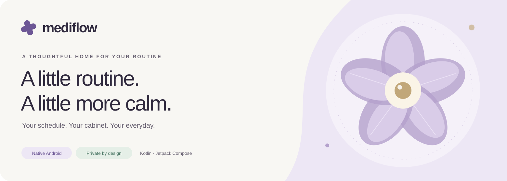
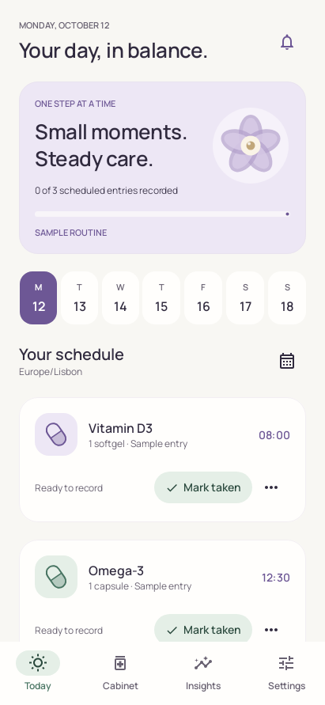
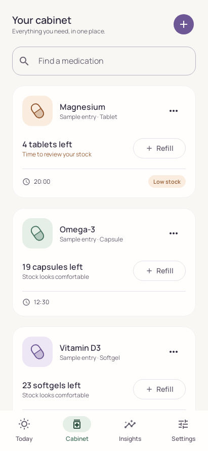
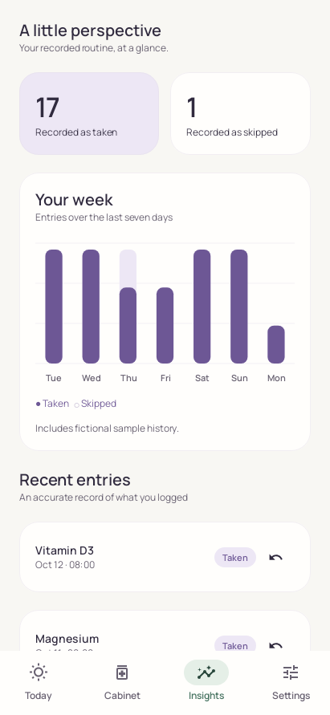

<p align="center"></p>

# MediFlow

A considered home for everyday medication routines. Native Kotlin and Jetpack Compose, with a warm ivory and lilac design, deliberate typography, and a fully local data model.

**Android 8.0+ · Kotlin · Jetpack Compose · Room · Hilt · Coroutines · Material 3**

MediFlow brings together a daily schedule, a medication cabinet, recorded history, and device reminders. It organizes the schedules people enter; it does not recommend treatments or calculate prescriptions.

## The experience

| Today | Cabinet | Insights | Settings |
| --- | --- | --- | --- |
| A calm daily timeline, week selector, and clear record/skip/undo actions. | Exact fractional inventory, search, refills, editing, and archiving. | Seven days of recorded entries and an undoable history. | Reminder permissions, discreet notification text, light/dark themes, and portable backups. |

The Android app begins with an empty routine or an explicitly selected fictional sample. Reminders remain off until enabled. Compact screens use bottom navigation; wider screens use a navigation rail.

<p align="center">
  
  
  
</p>

Native captures are rendered from the Compose interface in the automated Android journey.

## Explore

- **Android preview:** `downloads/MediFlow-1.0.0-preview.apk`, an optimized, development-signed build. This is a preview artifact, not a store distribution.
- **Interactive companion:** open the included `index.html` in a browser. It is self-contained, including fonts, styling, scripts, and fictional sample data; it requires no server or account.
- The companion supports recording, undo, fractional stock, editing, archiving, themes, and compatible backup files. OS notifications run in the Android app. Browser settings remain separate from Android settings.

## Engineering decisions

- **A pure Kotlin domain:** deterministic recurrence, local-clock and home-zone travel policies, DST gap/overlap handling, and stable logical occurrence identifiers.
- **Room transactions:** recording and stock updates commit together. Repeated actions are idempotent. Undo restores the quantity recorded at that moment. Optimistic revisions reject stale medication edits.
- **Platform-aware reminders:** immutable PendingIntents, distinct action identities, exact alarms when authorized, approximate fallback, persistent snoozes, and reconciliation after reboot, clock changes, app updates, and foreground resume.
- **Local privacy:** no account, analytics, advertising, cloud backend, or Internet access permission. Room stores the routine; DataStore stores preferences. Android system backup is disabled. Export is a deliberate document-picker action.
- **Adaptive presentation:** bundled Manrope typography, original vector illustrations, Compose semantics, minimum touch targets, light/dark schemes, and preserved editor drafts during activity recreation.
- **Reviewable quality:** domain and Room integration tests, Android reminder reconciliation tests, a native Compose journey, browser interaction checks, automated accessibility checks, lint, and a device benchmark harness.

## Modules

| Module | Responsibility |
| --- | --- |
| `app` | Application composition, platform permissions, document import/export |
| `core:model` | Domain models, recurrence engine, inventory policy, repository ports |
| `core:data` | Room, DataStore, atomic operations, validated backup format |
| `core:reminders` | AlarmManager, notifications, receivers, WorkManager maintenance |
| `core:designsystem` | Theme, typography, original illustrations, reusable components |
| `feature:routine` | StateFlow/ViewModel presentation and the four product destinations |
| `benchmarks` | Cold-start measurements and baseline-profile collection journeys |

## Development

Use **JDK 17**, **Android SDK 36**, and **Build Tools 36.0.0**. The Gradle 8.13 wrapper and dependency versions are committed. Set `ANDROID_HOME` or a local `sdk.dir` before building.

```sh
./gradlew :app:assembleDebug
./gradlew :core:model:test :core:data:testDebugUnitTest :core:reminders:testDebugUnitTest :app:testDebugUnitTest :app:lintDebug
```

The optimized preview variant uses R8 and development signing:

```sh
./gradlew :app:assembleBenchmark
```

The standalone companion can be rebuilt and checked with Node.js 20+:

```sh
npm ci
npm run build:demo
npm test
npx playwright install chromium
npm run test:ui
```

`web/src/` is the readable source for the companion. `index.html` is its distributable output. No network is used by the companion at runtime; dependency downloads are needed for development.

## Documentation

- [Architecture and invariants](docs/ARCHITECTURE.md)
- [Reminder behavior and device conditions](docs/REMINDERS.md)
- [Verification record](docs/VERIFICATION.md)
- [Privacy and backup format](docs/PRIVACY.md)
- [Visual system](docs/DESIGN.md)
- [Third-party notices](THIRD_PARTY_NOTICES.md)

## Provenance and NDA boundaries

MediFlow is an independently developed portfolio application. No source code, private APIs, customer or patient data, internal documents, branding, or proprietary design assets from a current or former employer are included. The implementation and visual identity are original to this project, and all demonstration entries are fictional. This repository does not represent or reproduce an employer's product.

Original project code is available under the [MIT License](LICENSE). Bundled fonts and third-party libraries retain their respective licenses.
